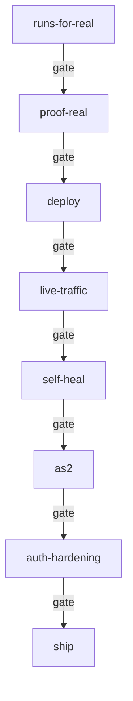

# Mission State — shipwright-forge (schema v2)

## Meta
- **Mission**: Latch — production launch
- **Plain Goal**: Latch runs on the live site, a new partner connection can be set up and proven in the browser, and files can flow in and out securely with real sign-in.
- **Goal Classes**: software
- **Created**: 2026-11-19
- **Last Updated**: 2026-11-19
- **Current Release**: mvp
- **Current Phase**: (awaiting contract approval)
- **Status**: hold
- **Baton**: pathfinder

Status values: in-progress | gate-check | hold | blocked | passed | complete
Baton values: none | pathfinder | forgemaster | builder | operator | sentinel

## Decode Contract

### The Ask
"/shipwright-forge:run" with no goal text — inferred from the session: "identifies ... all remaining items or phases to complete this to production ready launch", then "Yes" to fixing the findings.

### Real Goal
Close every gap between "engine proven in tests" and "Latch deployed on Cloudflare, usable end to end in a browser, with live transport, working self-heal and real auth".

### Goal Transform
| Vague term in the ask | Hard gate (DoD ref) | Framework applied |
|-----------------------|---------------------|-------------------|
| "production ready" | Deployed URL passes an automated end-to-end smoke run; 0 high/critical prod advisories (D-7, D-6) | Production-readiness review: readiness = evidence from the running system, not from unit tests |
| "launch" | Owner chose "Deployed to Cloudflare": latch.tp-freight.com serves the app; partner GA is out of scope (D-7) | Scope by decision owner (answers ledger) |
| "all remaining items" | Each audit phase A–E maps to ≥1 DoD line; phase F excluded by the owner's finish-line choice (Ask Coverage) | No-silent-scope-shrink mapping |
| "correct" (CLAUDE.md §2.1) | No map reaches production without confirmed anchors + benchmark bar; LLM pass-rate measured, never trusted (D-1, D-2, D-3) | docs/07 verification bar |
| "runs" | Every Durable Object, queue and crypto path has a test on the real Workers runtime in CI (D-4, D-5) | Test-in-production-runtime (lesson from the handshake crash) |

### The End State
- A person onboards a partner in the browser with their own guide and sample files, reviews what each file means, and reaches a passing certification and go-live — verify: Playwright run against `wrangler dev` — plain: the three-step flow really works in a browser with real files.
- AI map generation is measured on a real model, not assumed — verify: `pnpm eval:mapgen` prints first-attempt certification pass-rate — plain: we know how often the AI gets a map right first time.
- The bilateral handshake, queue consumer and stores run on the real Workers runtime in CI — verify: workerd test job green — plain: what passes in tests also runs in production.
- The app is live at latch.tp-freight.com and passes a smoke run — verify: `pnpm smoke --url https://latch.tp-freight.com` — plain: it is deployed and working.
- Files arrive over SFTP and AS2, replies go out with correct control numbers — verify: integration tests against an SFTP server and an independent AS2 implementation — plain: partners can exchange files with Latch securely.
- Breaking drift is repaired by a patched map that only goes live after re-certification and approval — verify: API test + real-key run — plain: self-heal actually fixes the map.
- Every request is authenticated and tenants cannot see each other's data — verify: cross-tenant suite — plain: real sign-in, and one customer can never see another's files.

### Honesty Floor
Full completion is the goal; truth outranks it. A declared SHORTFALL (state.md § Shortfall) is always a legal outcome and supersedes every completion clause in this contract. Closing any DoD line without its named verification passing on behavior-level evidence is the only violation.

### Beyond the Ask
- [BEYOND] B-1: Nightly re-certification of every production map with an alert on any regression — verify: cron handler test + one scheduled run logged on the deployed Worker — plain: every live connection is re-proven every night.
- [BEYOND] B-2: The AI map pass-rate is tracked on every pull request that touches the prompts, and a drop below the recorded baseline fails the check — verify: CI job output on a PR — plain: prompt changes can't quietly make the AI worse.
- [BEYOND] B-3: Rejection acknowledgements name the exact segment and element at fault (997 AK3/AK4) — verify: ≥6 tests of malformed files asserting the reported position — plain: when a partner's file is rejected, the reply says exactly where it is wrong.

### Ask Coverage
- Audit A (proof real) → D-1, D-2, D-3
- Audit B (run in production) → D-4, D-5, D-6, D-7, D-8
- Audit C (live traffic) → D-9, D-10, D-11
- Audit D (self-heal) → D-12
- Audit E (auth + hardening) → D-13, D-14, D-15
- Audit F (design-partner GA) → OUT OF SCOPE by the owner's finish-line choice; listed in Human Lane as the follow-on
- Repo health → D-16, D-17, D-18

### Goal Classes
software

### Reconstructed Request
Take shuddl/latch from `main` at 7db9f31 to a deployed, browser-usable, securely connected product. Build in gated phases, each merged by pull request with CI green: (1) runs for real — fix the handshake key-storage crash, serve the web app from the API Worker, upgrade vulnerable dependencies, add Workers-runtime tests to CI; (2) proof is real — confirm panel, guide/PDF upload and AI map generation in the UI, coverage derived from the partner's spec, an LLM regression set; (3) deploy — scripted provisioning, deploy from CI, smoke test; (4) live traffic — SFTP in, outbound emit-and-send, dead-letter queue; (5) self-heal completes; (6) native AS2 with receipts, proven against an independent implementation; (7) auth and hardening — Clerk, tenant provisioning, cross-tenant tests, alerts, retention, rotation runbook, share links; then final deploy and ship. Honour CLAUDE.md throughout: no LLM in the per-message path, no uncertified map in production, auth last, three-step hero flow, no committed secrets.

### Mission DoD
- [ ] D-1: A non-fixture 214 and a non-fixture 204 each go upload guide + samples → AI-generated map → review + confirm → certify PASS → go-live in the browser in ≤3 screens with 0 console errors — verify: `pnpm e2e` (Playwright vs `wrangler dev`, model stubbed for determinism) — plain: the whole setup flow works in a real browser with files that are not our demo file.
- [ ] D-2: An LLM regression set of ≥8 guide→spec→map cases across ≥4 transaction sets runs against the real Anthropic API and reports first-attempt certification pass-rate; baseline recorded in the repo — verify: `pnpm eval:mapgen` output + committed baseline file — plain: we have a measured number for how often the AI builds a correct map.
- [ ] D-3: Coverage targets (required segments, qualifier codes, loop shapes) and the synthetic coverage cases are derived from the connection's Latch Spec, with expected outputs computed without the model; 0 references to the standard reference corpus on the certify path for spec-backed connections — verify: unit tests + grep — plain: a partner's map is tested against that partner's own rules, not a generic template.
- [ ] D-4: `POST /v1/handshake/bilateral` returns 200 with a manifest carrying 2 valid Ed25519 signatures on the Workers runtime, and survives a Durable Object eviction mid-handshake — verify: workerd integration test — plain: two companies can complete the handshake on the real platform.
- [ ] D-5: ≥12 integration tests run on the Workers runtime in CI covering both Durable Objects, the queue consumer (incl. retry and dead-letter), and the D1/R2 store — verify: CI job log — plain: the parts that only break in production are tested the way production runs them.
- [ ] D-6: `pnpm audit --prod` reports 0 high and 0 critical advisories; wrangler is on the current major — verify: command output — plain: no known serious security holes in what we ship.
- [ ] D-7: `https://latch.tp-freight.com/v1/health` returns 200 and the deployed app passes the scripted hero-flow smoke run — verify: `pnpm smoke --url https://latch.tp-freight.com` exit 0 — plain: Latch is live on the internet and works.
- [ ] D-8: One documented command provisions every Cloudflare resource idempotently (second run changes nothing) and merges to `main` deploy automatically — verify: two consecutive provisioning runs + a CI deploy log — plain: anyone can stand the system up again, and updates ship themselves.
- [ ] D-9: A file dropped on an SFTP server is ingested, persisted, acknowledged with a 997 written back, and a poison file lands in the dead-letter queue without blocking the rest; a redelivered message creates 0 duplicate transactions — verify: integration test against a local SFTP server — plain: partners can send files by SFTP and nothing is lost or double-counted.
- [ ] D-10: `POST /v1/connections/:id/outbound` builds a certified outbound document (e.g. a 990 answering a 204) with control numbers from the per-connection sequencer, persists raw + canonical, sends via the connection's adapter, and is idempotent under retry — verify: API tests incl. a repeat with the same Idempotency-Key — plain: Latch can send documents back to partners, numbered correctly, exactly once.
- [ ] D-11: Native AS2 on Workers sends and receives signed + encrypted messages and exchanges signed receipts (MDN) with an independent open-source AS2 implementation in both directions; a tampered message is rejected — verify: interop test (external evidence) + ≥8 unit tests — plain: Latch speaks the secure protocol large partners require, proven against someone else's software.
- [ ] D-12: Breaking drift produces an AI-proposed patched map that is shadow re-certified; approval promotes it to the active map and the next identical file transforms cleanly; a failing patch never goes live — verify: API tests (stub model) + 1 recorded run on the real API — plain: when a partner changes their format, Latch proposes a fix, proves it, and applies it on your say-so.
- [ ] D-13: Every `/v1` route except health requires a valid Clerk session; the dev org header is rejected in production; a new organisation is provisioned on first sign-in; the handshake endpoint takes no tenant from the request body; ≥20 cross-tenant tests show 0 leaks — verify: test suite + a 401 from the deployed URL without a token — plain: real sign-in, and one customer can never reach another's data.
- [ ] D-14: Alerts fire on failed transactions, dead-letter depth and certification failures; R2 retention rules are applied; a secret-rotation runbook exists and has been executed once against the deployment — verify: alert test event received, lifecycle config readback, runbook execution log — plain: you are told when something breaks, old data is cleaned up, and keys can be changed safely.
- [ ] D-15: A certification report can be shared by a read-only link with ≥128 bits of entropy, an expiry, and revocation; an expired or revoked link returns 404 — verify: API tests — plain: you can send a partner proof of certification without giving them a login.
- [ ] D-16: Full harness green on the final commit: typecheck, lint, unit, workerd, e2e, build — verify: CI run URL — plain: every automated check passes.
- [ ] D-17: No stub or filler paths ship — verify: grep -rnE "TOD[O]|FIXM[E]|HAC[K]|not implemented|coming soon" over apps/ and packages/ = 0 hits — plain: nothing half-built is left in.
- [ ] D-18: Failure paths are proven: ≥40 tests across the mission feed bad input (malformed EDI, bad signatures, expired tokens, wrong tenant, oversized uploads) and assert the handled result; README, TASKS.md and docs/08 match the shipped behaviour — verify: test count by tag + doc review checklist — plain: we have tested what happens when things go wrong, and the docs are true.

### Authorizations
- commits and pushes to feature branches of shuddl/latch and opening draft PRs (never direct pushes to main; never merging)
- local commands: tests, builds, linters, local Workers runtime, file writes inside the repo
- Anthropic API spend up to $25 total for D-2, D-12 and B-2 once a key is provided
- registering artifacts in the armory and fleet
Still HOLD: creating or changing anything in the Cloudflare account, setting secrets, DNS changes, Clerk account setup, any spend beyond the line above, anything that contacts a third party.

### Assumptions Ledger
Answers (facts from the owner, 2026-11-19):
- Finish line: deployed to Cloudflare (not partner GA).
- AS2: build natively.
- Auth: include, as the last phase.
- Inputs available: Anthropic API key, Cloudflare access. Not available: real companion guides + samples, a partner SFTP endpoint.
Assumptions:
- Audience: Spencer as owner/operator; first external users arrive only after this mission.
- Each phase ships as its own pull request for the owner to merge; the loop waits at each merge.
- The web app is served from the API Worker (same origin) rather than adding CORS.
- SFTP is delivered as a small bridge feeding the existing ingest queue, proven against a local SFTP server.
- The sample-confirmation step stays mandatory (merged in PR #29) and counts as part of "watch it certify".
- Synthetic guides stand in for real ones in the LLM regression set.
- [⚠ Native AS2 on Workers is unproven: S/MIME (CMS) needs a pure-JS library that runs on the runtime. If none does, D-11 becomes a SHORTFALL with evidence, not a quiet downgrade — expensive if wrong]
- [⚠ No real partner guide is available, so D-2 measures the AI on synthetic guides only; real-guide quality stays unknown at ship — expensive if wrong]
- [⚠ Deploy, secrets and Clerk need the owner's hands at three points (provisioning approval, API key entry, Clerk keys); the loop holds at each — calendar depends on response time]
- [⚠ An independent AS2 implementation and an SFTP server must be runnable in CI or this container; if neither can run, D-9/D-11 evidence downgrades to recorded local runs]

### Failure Foresight
- AS2 crypto does not run on Workers → spike it first inside phase 6 with a go/no-go before building the adapter.
- Unit tests pass but the runtime fails (already happened twice) → phase 1 puts Workers-runtime tests in CI before any other feature work.
- LLM maps fail certification on first attempt → D-2 measures it; a repair loop (feed shortfalls back to the model, re-certify) is the planned response if the baseline is below 60%.
- Auth flip breaks existing tests and the dev flow → dev header stays available outside production; cross-tenant suite written before the flip.
- Owner merges lag the loop → phases are stacked on the previous branch only when independent; otherwise the loop holds.

### Second-Order Outputs
- A repeatable Workers-runtime test harness for future Durable Object work.
- A measured AI-quality baseline to quote to design partners.
- A provisioning script that doubles as disaster recovery.

### System Candidates
- Workers-runtime integration test pattern → forge candidate
- Provision + deploy + smoke sequence → forge candidate
- LLM regression harness (guide → spec → map → certify) → forge candidate

### Leverage (top 20%)
- Workers-runtime tests in CI (unblocks trust in everything after)
- Same-origin web + browser e2e (makes the product demoable)
- Spec-driven coverage + LLM regression set (the correctness claim)
- Provision/deploy script (the finish line itself)
- AS2 crypto spike (largest unknown)

### Upstream Contract
none

## Capability Map
(pending S1 FORGE)

## Release Plan
| Release | Scope Summary | Phases | Status | Gate Passed |
|---------|--------------|--------|--------|-------------|
| mvp | Deployed, browser-usable, securely connected Latch | runs-for-real, proof-real, deploy, live-traffic, self-heal, as2, auth-hardening, ship | not-started | ❌ |

## Phases & Gates

## Tasks (Current Phase)
| ID | Title | Status | Agent | Depends On | Size | Acceptance Criteria (what :: how to verify) | Plain (owner words) |
|----|-------|--------|-------|------------|------|---------------------------------------------|---------------------|

## Human Lane
| ID | Ask | Status | Since | Follow-up Task |
|----|-----|--------|-------|----------------|
| H-0 | Approve the End-State Contract | waiting | 2026-11-19 | — |

## Completed Tasks
| ID | Title | Phase | Completed At | Verified |
|----|-------|-------|--------------|----------|

## Relay Log
- 2026-11-19 · pathfinder · S0 · contract written, held for approval · .shipwright/state.md

## Capability Gaps
- (none)

## Shortfall
- (none)

## Armory Refs
| Artifact ID | Name | Source | Reuse |
|-------------|------|--------|-------|

## Delivery

## Decision Log
| Date | Decision | Rationale | Reversible |
|------|----------|-----------|------------|
| 2026-11-19 | Finish line = deployed to Cloudflare | Owner answer | yes |
| 2026-11-19 | AS2 built natively | Owner answer; highest-risk item, spike first | yes |
| 2026-11-19 | Auth included as the last phase | Owner answer; CLAUDE.md §2.3 | yes |

## Metrics Snapshot
- (not yet computed)
