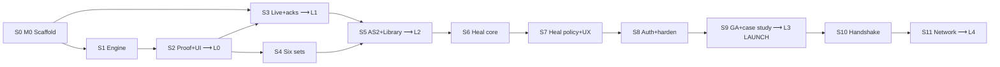

# Launch Plan — Needs, Sprints & Phases Through Launch

**Owner:** Spencer · **Build:** Claude Code (parallel agent tracks) · **Date:** 2026-06-20
**Source of truth:** `docs/10` (milestones) and `TASKS.md` (backlog). This file sequences them into **sprints**, defines the **launch gates**, and lists the **needs** that gate each phase. Read `REVIEW.md` first — its decisions (esp. **B1 oracle**) feed the engine sprints.

> **Estimates are effort-relative, not calendar promises.** They assume the three-track agent split (`docs/10`) running in parallel, real companion guides available by M1 (`REVIEW.md` N1), and Cloudflare connectivity de-risked in M0 (`REVIEW.md` R1). Slip on N1 or R1 cascades; everything else is internally controllable. Ranges are given as `[parallel → serial]` working weeks.

---

## 1. Launch is not one event — it's four gates

Latch "launches" in stages, each a real release with its own audience and its own proof. This is the spine of "phases through launch."

| Gate | Name | Milestone(s) | Audience | The proof at this gate | GTM unlocked (`12`) |
|---|---|---|---|---|---|
| **L0** | **Wedge demo** | M1 | Internal + design partner | A non-EDI user uploads a real 214 guide+samples → **green, benchmark-passing certification**, visually. | The demo that sells everything. Free-tool content can ship. |
| **L1** | **Design-partner live** | M2 (+ early M3) | The founding carrier | Real 214 traffic over a live pipe, 997s flowing, transactions replayable. | First named production story; case-study capture begins. |
| **L2** | **Self-serve beta** | M3 | Invited ICP firms | All six freight sets onboard+certify; AS2 + SFTP; Spec Library accreting. | **Open self-serve signup**; cutover-recovery campaign. |
| **L3** | **Paid GA** | M4 + M5 | Public, paid | Self-heal catches+fixes drift before production failure; auth + multi-tenant; design-partner estate live; case study published. | Launch **Self-Heal** paid tier; "dollars protected"; embed conversations. |
| **L4** | **Network** (post-launch) | M6 | Latch-aware partners | Two parties stand up a connection agent-to-agent with a signed co-cert manifest. | Launch **Network** tier; partner pull-through; spec-library moat compounds. |

**"Launch" in the everyday sense = L3 (Paid GA).** L0–L2 are the on-ramp; L4 is the endgame after launch. The plan below carries through L4 so nothing is a surprise, but the **critical path to a real launch ends at M5.**

---

## 2. Needs that gate each phase (resolve in this order)

These are the non-code prerequisites. A missing need blocks a gate regardless of build progress. (Cross-ref `REVIEW.md` §C/§D.)

**Before M0 build:**
- ☐ **N3** Cloudflare Workers **Paid** plan confirmed on `1d40…d466`; Anthropic API key in `.dev.vars`. *(REVIEW R3)*
- ☐ **B1** Verification-oracle approach approved (invariant oracle minimum; differential oracle preferred). *(REVIEW B1)*
- ☐ **D2** `frontend-design` skill provided, or green-light to define our own tokens. *(REVIEW D2)*

**Before M1 is *credible* (not just functional):**
- ☐ **N1** Real R&L 214 companion guide + 3+ sample files in hand. Synthetic fixtures unblock the build; real guides validate the wedge. *(REVIEW N1)*

**Before M2:**
- ☐ **R1** Connectivity spike done — one inbound + one outbound path proven in the real Workers runtime. *(REVIEW R1)*
- ☐ **N4** Confirmed: reuse partner's existing pipe vs. provision new. *(REVIEW N4)*
- ☐ **D4** First live flow direction chosen (inbound 214 vs. outbound 214/210). *(REVIEW D4)*

**Before M3 / L2:**
- ☐ **D5** Spec-Library anonymization policy defined. *(REVIEW D5)*
- ☐ **N2** Design-partner commitment in writing (case-study consent). *(REVIEW N2)*

**Before M4 / L3:**
- ☐ **D1** Self-heal auto-apply default policy ratified. *(REVIEW D1)*
- ☐ **D6** "Dollars protected" formula defined. *(REVIEW D6)*
- ☐ **N5** Price points validated with 2–3 ICP-adjacent firms. *(REVIEW N5)*
- ☐ Tenancy/identity model specified for Clerk (open-Q #8).

---

## 3. The sprint plan

Sprints are ~1–2 week units. The **track** column maps to the `docs/10` agent split: **E**=Engine (`spec/mapgen/transform/verify/heal`), **P**=Platform (`api/pipeline/connectivity/DOs/D1/R2/Queues`), **X**=Experience (`apps/web`). The injection harness is the shared contract that keeps tracks honest at every merge.

| Sprint | Milestone | Track(s) | Goal & key work | Exit criteria (DoD) | Effort `[∥→serial]` |
|---|---|---|---|---|---|
| **S0** | M0 | P, E, X | **Scaffold & ground.** pnpm+Turborepo; `apps/{api,web,pipeline}` + `packages/*` stubs; `wrangler.toml` bindings (D1/KV/R2/Queues/DO); D1 migrations for `06`; `edi-core` spike (wrap a vetted X12 lib, round-trip a 214); `canonical` types+Zod; dev-stub auth; `fixtures/` seeded (214); CI with injection-harness skeleton. **+ R1 connectivity spike** (de-risk SFTP/AS2 early). | `pnpm dev` runs api+web; `wrangler deploy` serves `/v1/health` on dev subdomain; CI green; sample 214 round-trips; connectivity spike verdict documented. | `1–2 wk` |
| **S1** | M1 (engine) | E | **The Proof, half 1.** `spec` Ingestor for 214 (Claude + samples-as-truth, per-field confidence, deviation flags, Zod-validated); `mapgen` inbound+outbound 214↔`StatusEvent` declarative rules; `transform` deterministic engine (`TransformResult`, raw passthrough). **Stand up the B1 oracle** (invariant + optional differential) and the LLM eval set (`REVIEW E5`). | A 214 guide → spec → map → canonical for the fixture corpus, no manual mapping; transform is pure & typed; eval set green. | `1.5–2.5 wk` |
| **S2** | M1 (proof+UI) ★ | E, X | **The Proof, half 2 + the wedge UI.** `verify` golden synthesis (valid/boundary/qualifier/loop/deviation/adversarial) + Verification Engine scoring vs benchmark bar; `apps/web` hero Screens 1–4 (drop → **live cert timeline** → **visual report**: heatmap, round-trip gauge, per-field drill-down w/ guide refs, adversarial panel); API onboarding+certify endpoints + async jobs/SSE; **injection harness in CI**. | **L0:** non-EDI user uploads real 214 guide+samples → green, benchmark-passing certification, visual, reproducible from one command and the UI. | `2–3 wk` |
| **S3** | M2 | P, X | **Live traffic + acks.** `connectivity` SFTP adapter (per S0 spike verdict); `apps/pipeline` `txn-ingest` consumer (parse→transform→persist canonical→**997**, with parse-outcome→997 linkage, `REVIEW E3`); `ConnectionDO` control-number sequencing + dup detection (**DO authoritative**, `REVIEW E2`); `go-live` promotion (cert-guarded); txn index/detail/**replay** in UI. | **L1:** drop a real 214 on the pipe → parsed, transformed, persisted, 997 returned, visible in UI; replay works; duplicates ignored. | `2–3 wk` |
| **S4** | M3 (sets) | E, P | **Widen to the freight core.** Extend ingest/mapgen/verify/transform to **204, 990, 211, 210, 997** (204↔990 pairing; 210 invoice; 211 BOL; **add stop↔freight linkage**, `REVIEW E4`); fixtures per set; outbound generation (emit 990 for 204; emit 214/210). | Each of the six sets onboards+certifies; inbound 204→canonical `Tender` + certified outbound 990 path. | `2–3 wk` |
| **S5** | M3 (transport+library) | P, E | **Second transport + the moat starts.** AS2 adapter (sign/encrypt/MDN, encrypted cert material; VAN documented+stubbed); Spec Library accretion (every passing cert normalizes a `spec_library` entry, per **D5** policy). | **L2:** all six sets certifiable; AS2 round-trips with MDN; Spec Library populated; self-serve signup can open. | `1.5–2.5 wk` |
| **S6** | M4 (heal core) ★ | E, P | **Self-Heal, half 1.** `heal` deterministic schema-drift detection vs certified spec + cheap-classify semantic anomaly (Workers AI), **non-blocking** in pipeline; patch proposal (Claude) → draft patched map → **shadow re-cert at full benchmark bar** (+ new drift case). | Injected drifted file → DriftEvent opens, patch proposed, passes shadow cert; live traffic never stalls. | `2–3 wk` |
| **S7** | M4 (policy+UX) | P, X | **Self-Heal, half 2.** Per-connection heal policy (auto-apply vs one-click approval, default per **D1**); last-good map stays live until applied; drift timeline + approval flow + monthly health / **"dollars protected"** view (formula per **D6**). | **L3 (part 1):** drift auto-applies within policy or waits for approval; timeline narrates it in plain English; health view rolls up dollars protected. | `1.5–2.5 wk` |
| **S8** | M5 (auth+hardening) | P, X | **Make it safe for real users.** **Clerk auth + multi-tenant flip** (the `tenant_id` columns go live; orgs/teams; per open-Q #8) — *the only point auth is built*; hardening (rate limits, observability/alerting, R2 lifecycle, secret-rotation runbook, error budgets); `SECURITY.md` (`REVIEW E8`). | External user signs up → connects → certifies → live **with auth on**; alerting + runbooks exist. | `2–3 wk` |
| **S9** | M5 (GA+case study) | X, all | **Design-partner GA.** UX polish to `09` bar; share-link cert; mobile-respectable health/approvals; onboard the design partner's **full** partner estate; capture before/after case study (time/cost/quality/drift). | **L3 (Paid GA):** design partner runs ≥N production connections; case study (`12`) documented and publishable; paid tier live. | `1.5–2.5 wk` |
| **S10** | M6 (protocol) | E, P | **Handshake, half 1.** `handshake` HSP state machine (`05`) in `HandshakeDO`; Ed25519 signing; co-certification reusing `verify`; the **Latch-aware shim** minimal HTTP contract. | Two tenants complete HELLO→spec-exchange→map-negotiation→co-cert→signed/countersigned manifest. | `2–3 wk` |
| **S11** | M6 (UX+activate) | X, P | **Handshake, half 2.** "Connect via Latch" flow + signed-manifest view; ACTIVATE binding + live traffic; drift re-opens co-cert (resumable DO). | **L4 (Network):** two parties (or tenant + shim) stand up a connection agent-to-agent, provably, in the UI; Network tier live. | `1.5–2.5 wk` |

**Critical path to launch (L3):** S0 → S1 → S2 → S3 → S4 → S5 → S6 → S7 → S8 → S9. **~17–27 working weeks** depending on parallelization and the N1/R1 dependencies. L0 (the wedge demo, the thing that sells) lands at **S2 — roughly 4.5–7.5 weeks in.** L4 (network) adds S10–S11 after launch.

---

## 4. Dependency & parallelization map

- **Engine (E)** leads S1, S4, S6 — the highest-IP, hardest track; start it first and keep it staffed.
- **Platform (P)** can build S3 connectivity scaffolding against the S0 spike while Engine finishes S2.
- **Experience (X)** owns the demo surface (S2) and the relief surfaces (S7, S9); load the `frontend-design` skill (D2) at S2.
- The **injection harness** is the integration contract: every track's output is only "done" when it passes the harness at the benchmark bar in CI.

---

## 5. Risk register (top risks → which sprint retires them)

| Risk | Impact | Likelihood | Mitigation | Retired by |
|---|---|---|---|---|
| **B1 oracle is tautological** → "proven" maps that are actually wrong | Existential (kills the moat) | Med | Invariant + differential oracles before any cert ships | S1 |
| **SFTP/AS2 won't run cleanly in Workers** (R1) | High (blocks live traffic) | Med-High | M0 spike; sidecar behind `ConnectivityAdapter` if needed | S0 (spike), S3/S5 (proof) |
| **No real companion guides** (N1) | High (wedge unproven on real mess) | Med | Acquire design-partner guides early; synthetic until then | before S2 credibility |
| **LLM quality regresses silently** with prompt edits | Med | High | LLM eval/regression set in CI (E5) | S1 |
| **Build-time AI cost runs hot** (R3) | Med | Med | Budget + alerts; cache by hash; cheap-classify where possible | S0 |
| **Auth flip leaks tenant data** at multi-tenant switch | High | Low-Med | `tenant_id` on every table from day 0 (already specified); test isolation at S8 | S8 |
| **Scope creep from adjacencies** (`13`) | Med | Med | Hard rule: no adjacency work in Phases 1–2; the core spine first | ongoing |

---

## 6. Definition of Launch-Ready (the L3 gate checklist)

Launch (Paid GA) is go when **all** hold:
- ☐ All six freight sets certify at the benchmark bar in CI (`07`).
- ☐ Self-heal catches an injected drift, shadow-certifies, and applies within policy — demonstrably, on a live connection.
- ☐ Clerk auth + multi-tenant isolation verified (no cross-tenant read).
- ☐ The design partner runs ≥N production connections; "dollars protected" is a real, defined number.
- ☐ Before/after case study written and cleared for publication (N2).
- ☐ Pricing live; activation/KPI instrumentation reporting (`12`).
- ☐ `SECURITY.md` + secret-rotation runbook + alerting in place.
- ☐ Hero flow still three steps. (If a fourth crept in, cut it.)

---

## 7. Immediate next actions — "let's get moving"

The moment **B1, N3, and D2** are answered (`REVIEW.md`), S0 starts. Concretely, sprint S0 opens with `TASKS.md` items **0.1–0.10** plus the **R1 connectivity spike**:

1. Init pnpm + Turborepo; create `apps/{api,web,pipeline}` and `packages/*` buildable stubs (TS strict, ESLint, Prettier, Vitest). *(0.1–0.2)*
2. `wrangler.toml` per worker with all bindings; account/zone from `.dev.vars`. *(0.3)*
3. D1 migrations for the `06` schema + runner + `default` tenant. *(0.4)*
4. `packages/shared` (ULIDs, logger, typed errors/Result, Zod utils, config). *(0.5)*
5. `packages/canonical` (`06` types + Zod). *(0.6)*
6. `packages/edi-core` X12-lib spike → round-trip a 214 byte-faithfully. *(0.7)*
7. Dev-stub auth middleware (`X-Latch-Dev-Org`). *(0.8)*
8. `fixtures/` — ≥3 realistic 214 samples + 1 sample guide (synthetic until N1 lands). *(0.9)*
9. CI: typecheck + lint + Vitest + injection-harness skeleton. *(0.10)*
10. **R1 spike:** prove one inbound + one outbound connectivity path in the real Workers runtime; document the verdict.

**Recommended start order:** answer the three blockers → I open a tracking PR for S0 → Engine + Platform tracks begin in parallel, Experience joins at S2. Approve this plan (or amend the gates/defaults) and I'll begin S0.
