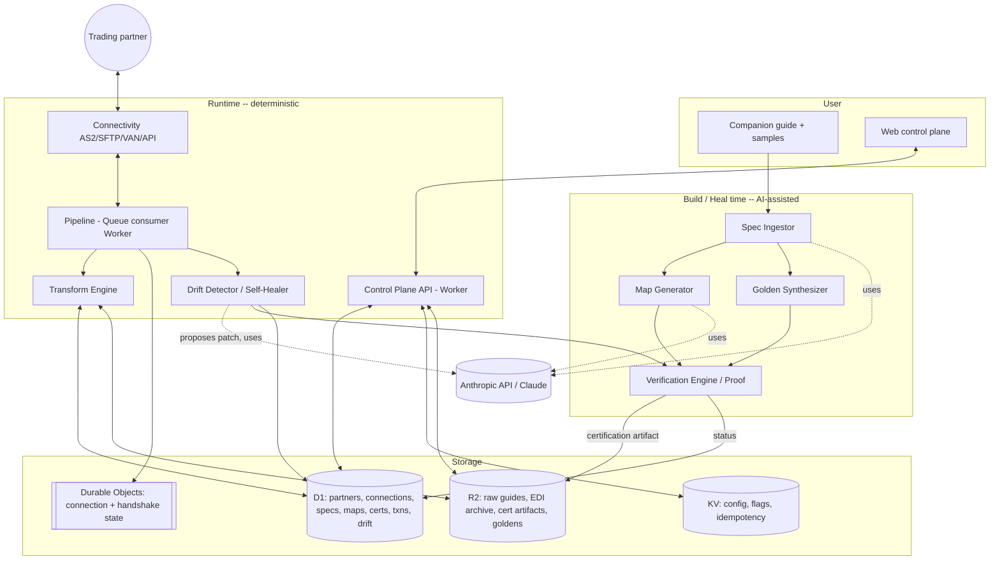
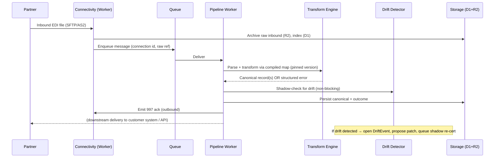
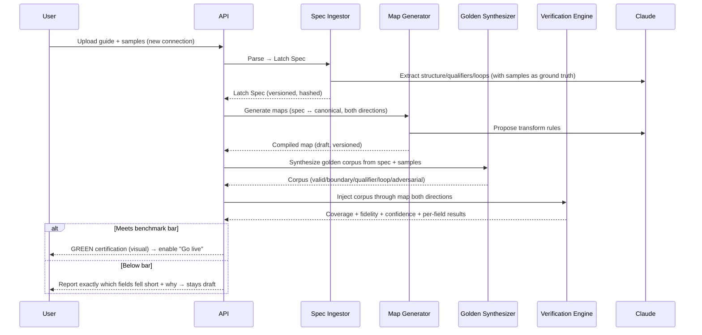

# 04 — Architecture

Cloudflare-native, TypeScript everywhere, deterministic at runtime, AI confined to build/heal time. This doc is the structural source of truth.

## Principles

1. **Build-time vs runtime split.** Heavy reasoning (guide parsing, map generation, heal proposals) happens at build/heal time and produces **compiled, versioned artifacts**. The runtime executes those artifacts deterministically. No LLM in the per-transaction path.
2. **Everything is an artifact with a version and a hash.** Specs, maps, golden corpora, certifications — all content-addressed, immutable once promoted, replayable.
3. **The canonical model is the hub.** All maps go partner-spec ↔ canonical. This is what makes "integrate once" real (`06`, `07`).
4. **Stateless Workers + stateful Durable Objects.** Workers handle requests and queue consumption; Durable Objects hold per-connection and per-handshake state.
5. **Audit and replay are first-class.** Raw in, canonical, raw out, acks — all persisted to R2 + indexed in D1.

## Components

| # | Component | Package | Build/Run | Responsibility |
|---|---|---|---|---|
| 1 | **Spec Ingestor** | `spec` | build | Parse companion guide (PDF/DOCX/XLSX/text) + sample EDI → the **Latch Spec** (machine-readable: segments, elements, loops, qualifiers, usage, deviations). LLM-assisted. |
| 2 | **Canonical Model** | `canonical` | both | The semantic hub: `Shipment`, `Tender`, `TenderResponse`, `BOL`, `StatusEvent`, `Invoice`, `Ack`. Zod-validated. |
| 3 | **Map Generator** | `mapgen` | build | Generate bidirectional transforms (spec ↔ canonical) as **compiled deterministic code/data**, versioned. LLM-assisted at build time only. |
| 4 | **Transform Engine** | `transform` | run | Execute a compiled map deterministically on a transaction. Pure, fast, repeatable. |
| 5 | **Golden Record Synthesizer** | `verify` | build | From spec + samples, synthesize the test corpus: valid, boundary, every-qualifier, every-loop, known-deviation, adversarial/malformed. |
| 6 | **Verification Engine (the Proof)** | `verify` | build | Inject the corpus through the map both directions; compare to golden records; score coverage/fidelity/confidence; produce the certification. **The moat.** |
| 7 | **Connectivity Layer** | `connectivity` | run | AS2 / SFTP / VAN / API adapters behind one interface. Inbound + outbound. |
| 8 | **Drift Detector + Self-Healer** | `heal` | both | Stream-watch live transactions; detect schema/semantic drift; propose patch; shadow re-certify; auto-apply within policy. |
| 9 | **Handshake Negotiator** | `handshake` | both | Phase 3 bilateral negotiation + co-certification + cryptographic attestation. |
| 10 | **Control Plane / API** | `apps/api` | run | REST API, orchestration, the visual app's backend. |
| 11 | **Spec Library** | (data in D1/R2) | — | The accreting, normalized library of proven partner specs. The network/moat. |
| 12 | **Web (visual)** | `apps/web` | run | React control plane + certification reports + drift timeline. |

## System diagram

## Transaction processing pipeline (runtime, deterministic)

## Certification flow (build time)

## Data flow & storage model (summary; full schema in `06`)

- **D1** — relational source of truth: `partners`, `connections`, `specs`, `maps`, `golden_corpora`, `certification_runs`, `transactions`, `drift_events`, `handshake_sessions`. Indexed for the dashboard.
- **R2** — large/immutable blobs: raw companion guides, raw inbound/outbound EDI, compiled map artifacts (optionally), golden corpora payloads, certification report bundles.
- **KV** — feature flags, hot config per connection, idempotency keys, control-number sequences (with D1 as durable backstop).
- **Durable Objects** — `ConnectionDO` (per-connection sequencing, rate limits, in-flight state), `HandshakeDO` (per-negotiation state machine).
- **Queues** — `txn-ingest` (inbound), `txn-egress` (outbound), `recert` (shadow certification jobs).
- **Cron** — drift sweeps over recent traffic; scheduled re-certification; archive lifecycle.

## Map artifacts: how a map is represented

A map is a **versioned, declarative transform spec** (data) plus a **deterministic interpreter** (`transform`). Prefer a declarative rule representation (JSON/TS data) the interpreter executes, over generated imperative code — it is easier to diff, certify, patch (self-heal), and attest. Each map record carries: `id`, `connection_id`, `direction` (`inbound`|`outbound`), `transaction_set`, `spec_version`, `rules` (declarative), `compiled_hash`, `status` (`draft`|`certified`|`production`|`retired`), and a link to its latest `certification_run`. **Only `certified` maps can be promoted to `production`, and only via a passing certification at the benchmark bar.**

## AI usage (build/heal time only)

- **Spec Ingestor:** Claude extracts structured spec from the guide, using sample files as ground truth and flagging guide-vs-sample deviations. Output is validated against a Zod schema; low-confidence fields are marked for review, never silently accepted.
- **Map Generator:** Claude proposes declarative transform rules per element/qualifier/loop; the Verification Engine is the arbiter of correctness, not the model's confidence.
- **Self-Healer:** Claude interprets a detected drift and proposes a rule patch; the patch is **only** adopted after passing shadow certification.
- **Hard rule:** model output is *a proposal*; **the Verification Engine is the gate.** No artifact reaches production on model confidence alone.

## Security & tenancy

- Single-tenant for dev; design tables with a `tenant_id` column from day one so multi-tenant is a switch, not a migration.
- Secrets in Cloudflare secrets; partner AS2 certs and SFTP keys stored encrypted (KMS-style envelope; never plaintext in D1).
- Auth deferred (CLAUDE.md §2.3) — dev-stub middleware now, Clerk later.
- All partner data archived in R2 with lifecycle rules; PII in freight data is limited but treat addresses/contacts as sensitive.

## Scaling notes

- Workers + Queues scale horizontally; the transform engine is pure and parallelizable.
- D1 is sufficient for control-plane scale; high-volume transaction *bodies* live in R2, not D1 (D1 holds metadata/index only).
- Durable Objects pin per-connection ordering where a partner requires strict control-number sequencing.
- Certification and heal jobs are async (Queues/Cron) and never block live traffic.
