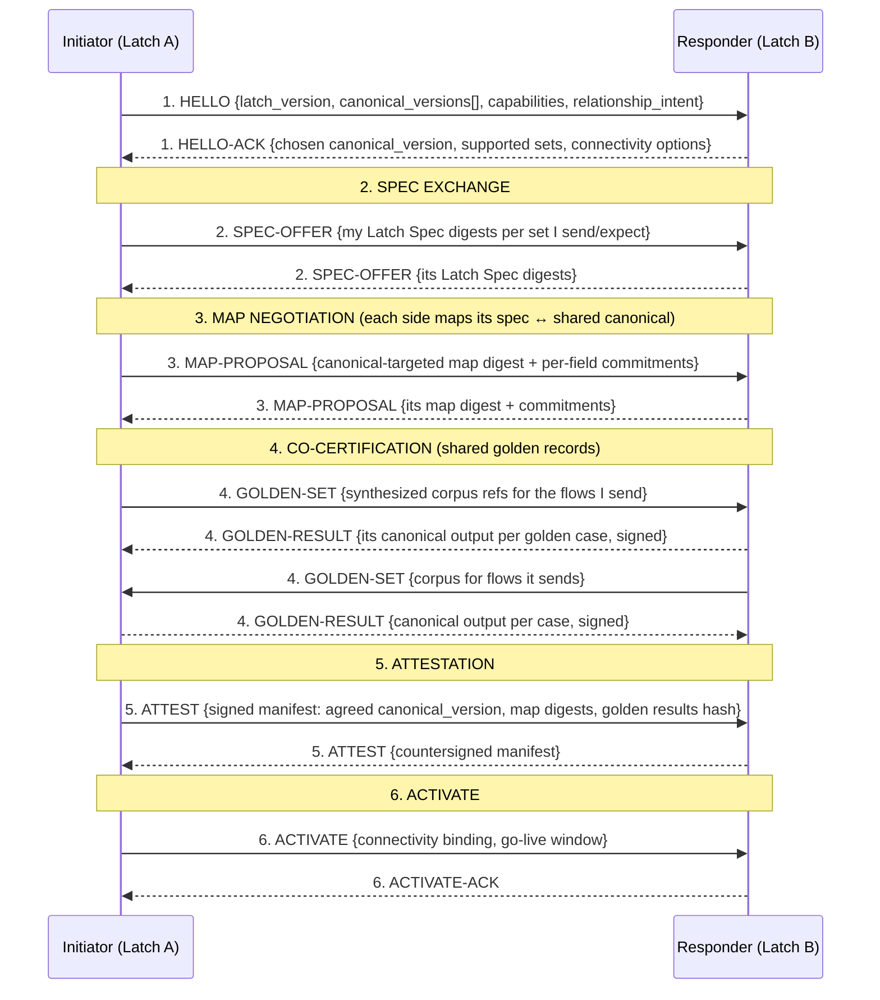

# 05 — The Latch Handshake Protocol (HSP)

This is the novel, defensible core. It is the EDI equivalent of a TLS handshake or an OAuth flow: a standardized, automated, mutual negotiation-and-certification between two trading partners' systems that compresses the human cert round-trip toward zero. **Design it fully now; build it in Phase 3.** The one-sided MVP (Phases 1–2) is the on-ramp and must work without any of this.

## Design goals

1. **Zero human round-trips** to stand up a connection when both sides are Latch-aware.
2. **Provable mutual agreement.** Both sides finish holding a **signed certification manifest** attesting they agree on the mapping and the golden-record results.
3. **Graceful degradation.** If the counterparty is not Latch-aware, fall back to one-sided onboarding (Phase 1) with no loss of correctness — just less automation.
4. **No trust required.** Neither side must expose internal systems; they exchange specs, golden records, and signed attestations, not databases.
5. **Versioned and resumable.** A handshake is a state machine persisted in a `HandshakeDO`; it can pause, resume, and re-run on drift.

## Participants & roles

- **Initiator** — the side that starts the handshake (typically the smaller/onboarding party).
- **Responder** — the counterparty's Latch (or a Latch-aware shim).
- **Relationship** — directional flows to establish (e.g. R&L→TP: 204, 211; TP→R&L: 214, 210, 997, 990).
- **Canonical Model version** — both sides must agree on a canonical-model major version (Latch's semantic hub). This is the shared language that makes mutual mapping possible.

## The handshake, phase by phase



### Phase 1 — HELLO (capability negotiation)
Exchange Latch protocol version, supported canonical-model versions, transaction sets each side can send/receive, connectivity options (AS2/SFTP/API), and the `relationship_intent` (which directional flows to set up). Output: a chosen canonical-model version and the set of flows to certify. Fail → fall back to one-sided onboarding.

### Phase 2 — SPEC EXCHANGE
Each side shares **digests** of its Latch Spec for the flows it will send (segments/elements/qualifiers/loops it populates). Digests, not full guides — enough to map against, nothing proprietary beyond the wire format they'd send anyway. Each side now knows exactly what bytes the other will emit.

### Phase 3 — MAP NEGOTIATION
Each side independently generates a map between **its own spec and the shared canonical model** (the same `mapgen` used in Phase 1). It publishes a **map digest** and **per-field commitments** ("I will populate canonical `Shipment.consignee.name` from `N1*CN`/`N2`"). Because both map to the same canonical model, agreement is reduced to: *do both sides' canonical interpretations line up?* No direct spec-to-spec mapping is needed — the canonical hub eliminates the N×N problem.

### Phase 4 — CO-CERTIFICATION (the heart)
The sender of each flow provides a **golden-record corpus** (synthesized from its spec, `verify`). The receiver runs the corpus through *its* inbound map and returns the resulting **canonical records, signed**. Latch on each side checks that the receiver's canonical output matches the sender's intended canonical meaning for every case — including qualifiers, loops, and adversarial inputs. This is mutual, automated certification: each side proves to the other that it correctly understands what will be sent. Output: a co-certification result hash.

### Phase 5 — ATTESTATION
Both sides sign a **certification manifest**: agreed canonical version, both map digests, the co-certification result hash, timestamp, and protocol version. Each countersigns the other's. The manifest is the cryptographic proof both sides agree — the artifact that replaces weeks of human cert sign-off. Store it (R2 + D1) on both sides.

### Phase 6 — ACTIVATE
Bind connectivity (reuse existing pipe or provision), set a go-live window, exchange `ACTIVATE`/`ACTIVATE-ACK`. The connection moves to `production`. Live traffic begins; self-healing (Phase 2 capability) takes over monitoring.

## Message envelope (transport-agnostic)

All HSP messages share an envelope; transport may be HTTPS (Latch-to-Latch), or a Latch-aware webhook/shim for partners not fully on Latch:

```jsonc
{
  "hsp_version": "1.0",
  "session_id": "hs_...",          // HandshakeDO id
  "type": "HELLO | SPEC_OFFER | MAP_PROPOSAL | GOLDEN_SET | GOLDEN_RESULT | ATTEST | ACTIVATE | ERROR",
  "seq": 3,
  "sender": { "latch_org": "...", "key_id": "..." },
  "payload": { /* type-specific */ },
  "sig": "base64(ed25519 over canonicalized envelope minus sig)"
}
```

- **Signing:** Ed25519 per Latch org; public keys exchanged at HELLO and pinned for the session. All `GOLDEN_RESULT` and `ATTEST` payloads are signed and verified.
- **Idempotency:** `(session_id, seq)` is unique; replays are no-ops. State lives in `HandshakeDO`.
- **Errors:** `ERROR {code, phase, detail, recoverable}`. Recoverable errors allow retry; non-recoverable end the session and trigger one-sided fallback.

## State machine (HandshakeDO)

```
INIT → HELLO_SENT → HELLO_OK
     → SPECS_EXCHANGED
     → MAPS_PROPOSED
     → COCERT_RUNNING → COCERT_PASSED | COCERT_FAILED
     → ATTESTED
     → ACTIVE
(any) → FAILED → (fallback: one-sided onboarding)
```

Each transition is persisted; the DO can resume after interruption and re-enter COCERT on drift (a drift event re-opens co-certification rather than a fresh handshake).

## Latch-aware shim (partner not fully on Latch)

A partner who won't adopt the full platform can still benefit via a thin **Latch-aware shim**: a small endpoint (or even a published static spec + a golden-result callback) that lets the partner participate in SPEC_OFFER and GOLDEN_RESULT without running Latch internally. This widens adoption and is the bridge between one-sided (Phase 1) and full bilateral (Phase 3). Spec it as an optional, minimal HTTP contract.

## Security & threat model

- **No internal exposure:** only specs (which describe bytes the partner already sends), golden records, and signatures cross the wire.
- **Tamper-evidence:** signed manifests + result hashes make any post-hoc disagreement detectable.
- **Replay/forgery:** Ed25519 sigs + session-pinned keys + `(session_id, seq)` idempotency.
- **Downgrade safety:** falling back to one-sided onboarding never lowers correctness (same Verification Engine), only automation.
- **Key rotation:** keys are per-session-pinned; rotation re-runs HELLO.

## Why this is the 50× and the moat

- It removes the **two-sided human round-trip** — the dominant cost driver one-sided AI mapping can't touch.
- The **canonical hub** collapses N×N spec mapping to N×1.
- The **signed co-certification manifest** is provable correctness *between organizations*, not just within one — the unsolved frontier.
- It compounds the **Spec Library** moat: every handshake (and every one-sided onboarding) adds a proven spec, making the next connection faster and the network more valuable. There is no forcing function in the market for this today, which is exactly why owning the protocol and the library is durable.
