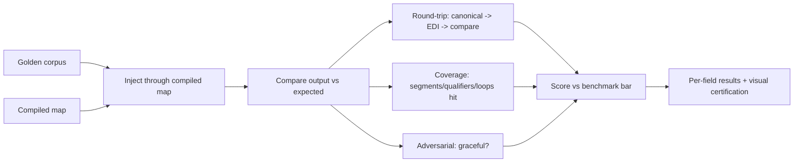
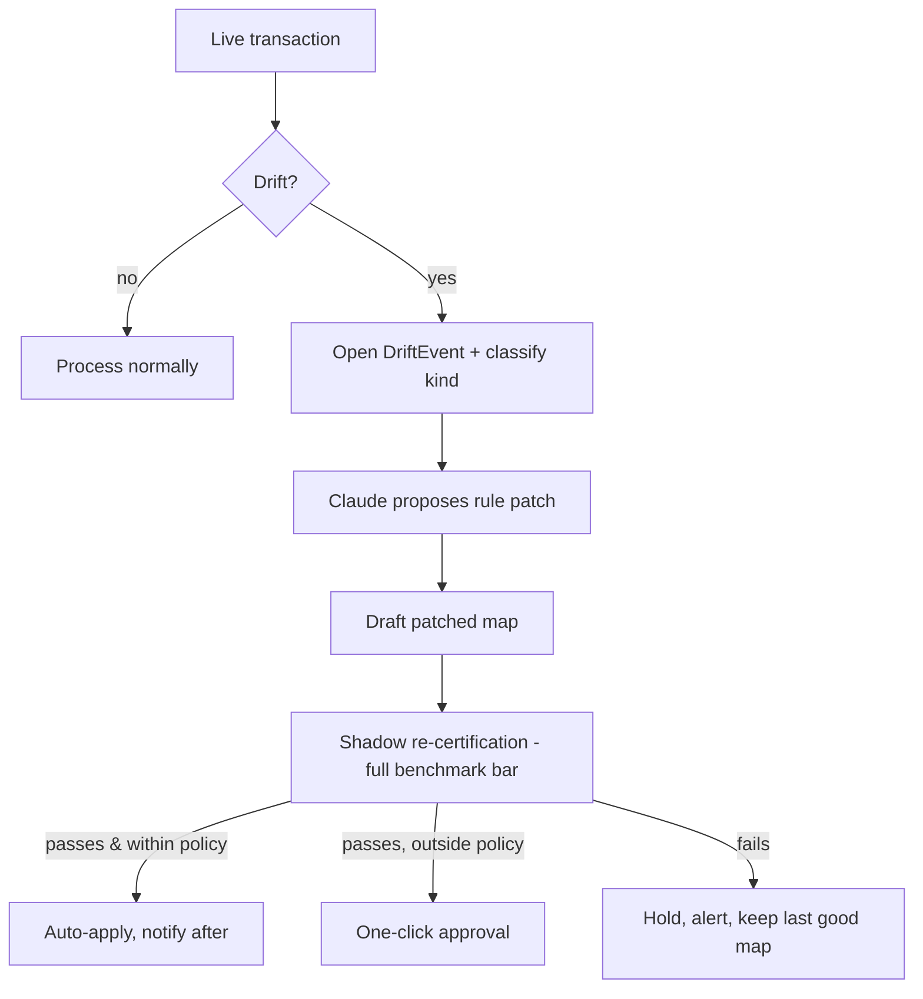

# 07 — Verification, EDI Injection & Self-Healing

This is the moat. Everything else in Latch is competent table stakes; **provable correctness is the wedge.** Build the Verification Engine in Milestone 1 and never weaken it. The same engine powers (a) initial certification, (b) co-certification in the bilateral handshake, and (c) shadow re-certification during self-healing.

## The thesis (why this is the whole product)

Competitors generate a map and hand you an **accuracy score** plus a human review step — because a 92%-correct map silently produces a structurally valid file with the *wrong meaning*, which corrupts invoices and drops shipments. Latch replaces "trust the model's confidence" with "**prove it by injection against golden records**." If we can certify a map automatically and provably, we remove the human from the loop and earn the right to say **$0 setup, same-day, guaranteed correct.**

## Definitions

- **Golden record** — a known-correct `(EDI input, expected canonical output)` pair (and its reverse for outbound), derived from the partner's companion guide and sample/real files.
- **Golden corpus** — the full synthesized set of golden records spanning valid, boundary, every-qualifier, every-loop, known-deviation, and adversarial/malformed cases.
- **EDI injection** — running the corpus *through the actual compiled map* (the same deterministic engine used in production), in both directions, and comparing outputs to expected.
- **Round-trip fidelity** — EDI → canonical → EDI reproduces every populated element. The strongest automatic correctness signal.
- **Certification** — a scored, visual artifact attesting the map meets the benchmark bar. The unit of trust.

## The benchmark bar (a map may reach `production` only if all hold)

| Dimension | Threshold | Meaning |
|---|---|---|
| Required-segment coverage | **100%** | Every required segment/element named in the guide is exercised by the corpus and mapped correctly. |
| Qualifier coverage | **100%** | Every qualifier code in the guide is exercised at least once and mapped correctly. |
| Loop coverage | **100%** of loop shapes in guide/samples | Min, typical, and max repetition exercised. |
| Round-trip fidelity | **≥ 99.9%** element-level | Lossless EDI→canonical→EDI on the valid+boundary corpus. |
| Adversarial handling | **100% graceful** | Malformed/out-of-spec inputs are rejected or flagged with a clear reason — **never silently mis-mapped.** |
| Deviation handling | **100%** of sample-observed deviations | Real partner deviations from their own guide are handled as observed. |

Below bar → map stays `draft`; the report shows **exactly which fields/qualifiers/loops fell short and why**, with the source guide reference and the offending case. No hand-waving, no partial green.

## Golden Record Synthesis (`packages/verify`, build time)

Inputs: the Latch Spec (`06`) + sample/real EDI. Output: a `golden_corpus`. Strategy:

1. **From samples (ground truth):** every provided real file becomes a golden record; its expected canonical output is derived and human-confirmable in the UI. Real traffic is the highest-value truth.
2. **From the spec (coverage):** synthesize cases to hit 100% of required segments, every qualifier value, and each loop's min/typical/max repetition. Use realistic freight values (valid SCACs, plausible weights/classes, ISO dates).
3. **Boundary cases:** empty optional segments, max field lengths, max loop repetitions, missing-but-optional elements, unusual-but-valid qualifier combinations.
4. **Deviation cases:** for every guide-vs-sample mismatch the ingestor flagged, include a case reflecting the *observed* behavior.
5. **Adversarial/malformed:** truncated segments, wrong delimiters, out-of-range qualifiers, mis-counted `SE`/`GE`, bad control numbers, unexpected segments. Expected outcome = **graceful rejection/flag with a precise reason.**

AI assists synthesis (realistic value generation, edge-case ideation) but **expected canonical outputs for spec-derived cases are computed deterministically from the spec, not by the model** — otherwise we'd be grading the map against the model's guess. For sample-derived cases, the operator confirms the expected output once (a fast visual step), and it's locked.

## The Verification Engine (the Proof)

Algorithm per direction:
1. For each golden record, run the compiled map (production engine) on the input.
2. **Compare** output to expected canonical (deep, field-level, qualifier-aware). Record pass/fail + diff per field.
3. **Round-trip:** serialize canonical back to EDI via the outbound map; compare to the original input element-by-element; record fidelity.
4. **Coverage:** track which required segments / qualifiers / loop shapes were exercised; compute coverage %.
5. **Adversarial:** confirm each malformed case was rejected/flagged with a reason, not silently transformed.
6. **Score** against the benchmark bar; emit a `certification_run` row + per-field results (R2) for the visual report.

**The engine, not the model, is the gate.** A map generated with 70% model confidence that passes injection is `certified`; a map generated with 99% model confidence that fails injection is not. Confidence theater is banned.

## EDI Injection harness (the literal "tested, performed, proven")

- A reusable harness that takes `(map, corpus)` and produces a full result set, runnable as: a Vitest suite (CI gate), a queue job (`recert`), and an on-demand API call from the UI.
- Deterministic and replayable: same `(map_hash, corpus_hash)` → same result. Results are cached by hash.
- The harness is also the **regression net**: every map version must pass before promotion; every heal patch must pass in shadow.
- Seed `fixtures/` with real (anonymized) and synthetic EDI for the six sets so the harness has teeth from Milestone 1.

## Self-Healing (`packages/heal`, Phase 2 — the recurring tier)

Drift is detected on live traffic and never allowed to silently break production.

**Drift detection (deterministic + cheap-classify):**
- **Schema drift:** new/unseen segment, new qualifier value, changed loop structure, element-length/position changes vs the certified spec. Detected deterministically against the spec — no LLM needed.
- **Semantic anomaly:** values outside learned distributions (e.g. a status code never seen, a weight unit flip). Cheap classifier (Workers AI) flags; deterministic rules confirm.
- Detection runs **non-blocking** in the pipeline (shadow), so live processing is never delayed by it.

**Patch + shadow re-cert:**
- Claude proposes a *declarative rule patch* (e.g. "map new qualifier `ZZ` on `N9` to `Reference{qualifier:'ZZ'}`").
- A draft patched map is produced and run through the **full benchmark bar** (plus the new drift case) in shadow.
- **Policy gate:** per-connection policy decides auto-apply vs approval (e.g. auto-apply if patch only adds handling for new optional data and passes 100%; require approval if it changes existing field semantics).
- The last-good map keeps running until a patch is applied; nothing breaks while healing.

**Why self-healing is the monthly tier:** initial certification (Phase 1) is free and seeds the network; **keeping the connection alive forever** is the recurring value and the recurring charge (`12`). It is literal insurance against the "missing deliveries" disaster.

## Reporting (must be highly visual — see `09`)

Every `certification_run` and every heal produces a **shareable visual artifact**:
- A coverage **heatmap** (segments × qualifiers, green/amber/red).
- Round-trip fidelity gauge + the few non-lossless fields, if any, with diffs.
- A pass/fail header with the four headline numbers.
- Per-field drill-down with the **source guide reference** for each mapping (traceability).
- For heals: a **drift timeline** ("caught X at 02:14, patched, re-certified, applied — nothing for you to do").
- A **share link** (read-only) the operator can send the partner *instead of* a cert ping-pong.

## CI / quality gates

- The injection harness runs in CI against `fixtures/`; a PR touching `mapgen`/`transform`/`verify`/`canonical` fails if any seeded connection drops below bar.
- Golden corpora and certifications are content-hashed; results are reproducible and diffable across versions.
- A nightly Cron re-certifies all `production` maps against their corpora to catch any drift in dependencies.
