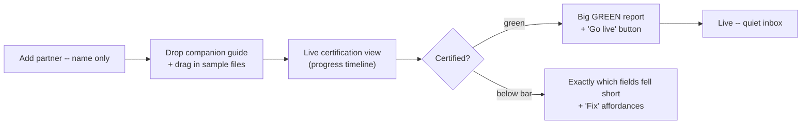

# 09 — UX & Visual Spec

The product is judged on exactly two things: **correctness** (`07`) and **how it feels** (this doc). "Highly visual" is a hard requirement. When building any UI, load the `frontend-design` skill first and follow its design-token guidance. Below is the experience spec.

## Design principles

1. **The hero flow is three steps. Protect it ruthlessly.** Drop a guide → watch it certify → click go-live. No fourth step on the happy path. No settings to configure before value.
2. **Show, don't tell.** Every state is visual: a live progress timeline during certification, a coverage heatmap for the proof, a drift timeline for self-healing. Numbers and color, not paragraphs.
3. **Plain English, always.** No raw X12, no stack traces, no qualifier codes in the primary view. The analyst can drill into the technical layer; the operator never has to.
4. **Confidence is communicated, never hidden.** Green means *proven*, not "probably fine." Anything short of proven is shown precisely, with the exact field and the source guide reference.
5. **Calm.** The emotional target for self-healing is *relief*: "we caught it, we fixed it, there's nothing for you to do."

## The hero flow (Phase 1)

### Screen 1 — Add a partner
One field: partner name (optional SCAC/IDs auto-detected from the guide/samples). A single primary action: **"Add files."** That's the whole screen.

### Screen 2 — Drop the guide + samples
A generous drop zone. Drop a PDF/DOCX/XLSX guide and drag in 1–N sample EDI files. Latch immediately, in plain English, reports what it found: *"Found a companion guide for **204 Load Tender** and **214 Status**, X12 004010. 3 sample files detected. Ready to build and certify."* One primary action: **"Build & certify."**

### Screen 3 — Live certification (the signature moment)
A **vertical progress timeline** animating through the real build steps, each flipping to ✓ as it completes:
1. Reading the companion guide…
2. Learning from your sample files…
3. Building the map…
4. Generating test cases (valid, boundary, every qualifier, edge & malformed)…
5. **Injecting tested EDI through the map…** (show a live counter: "1,284 / 1,510 cases passed")
6. Proving round-trip fidelity…
7. Scoring against the benchmark bar…

This screen *is* the demo. It makes the invisible (rigorous certification) visible and a little theatrical — in a good way. Keep it fast; if a step is slow, show partial results streaming, never a frozen spinner.

### Screen 4 — The certification report (visual proof)
A header with a verdict and four numbers:
> **CERTIFIED ✓** — Coverage 100% · Qualifiers 100% · Round-trip 99.97% · Edge cases 100% graceful

Then:
- **Coverage heatmap** — a grid of segments × qualifiers, green where proven, amber/red where not. The instant read of "everything is covered."
- **Round-trip gauge** — a dial at 99.97%, with the (ideally empty) list of any non-lossless fields.
- **Per-field drill-down** — expandable rows: canonical field ← source segment/element/qualifier, with the **guide page reference** and a sample value. This is where the analyst lives; the operator never opens it.
- **Adversarial panel** — "12 malformed inputs, all safely rejected with reasons." Confidence that bad data won't slip through.
- Two actions: **"Go live"** and **"Share with partner"** (read-only link that replaces the cert ping-pong).

If below bar: the same report, but the header is amber, and the failing fields are surfaced first with a one-line reason each and a **"Fix"** affordance (override the mapping, or upload a better sample), which re-runs certification.

### Screen 5 — Live (the quiet state)
A connection card: green health dot, today's volume, last transaction time, "0 exceptions." The product's resting state is *boring on purpose*.

## Self-healing UX (Phase 2 — emotional target: relief)

A **drift timeline** per connection, newest first. Each event is a calm, plain-English card:

> **2:14 AM — Caught a change.** R&L started sending a new reference qualifier (`ZZ`) on the 214. We mapped it, re-certified (100% ✓), and applied it automatically. Your deliveries kept flowing. **Nothing for you to do.**

For events needing approval (policy-gated):
> **Needs your OK.** R&L changed how they express delivery appointment windows. We've built and re-certified the fix (100% ✓ in shadow). **Apply it?** [Apply] [See what changed]

"See what changed" opens a **before/after diff** in plain English plus an optional technical view. The monthly health view rolls up: transactions processed, drift events caught, exceptions avoided, and a "**dollars protected**" estimate (value of shipments/invoices that would have failed) — the number that justifies the subscription.

## Dashboard (the control plane)

- **Connections grid:** one card per connection — partner, set, direction, health dot, volume sparkline, cert status. Filter by status. "Add connection" is always one click.
- **Activity:** a live feed of transactions and drift events across all connections.
- **Spec Library (internal/admin):** the accreting proven specs — a quiet flex of the moat and an asset for the team.

## Visual language

- **Color = proof, not decoration.** Green = proven. Amber = attention. Red = blocked/failed. Use sparingly and consistently; most of the UI is neutral with green accents (matches the avant-garde monochrome + restrained-accent house aesthetic if desired — see `frontend-design` skill).
- **Motion = progress.** Animation only communicates real state (certification steps, healing). No decorative motion.
- **Typography-led, generous whitespace, asymmetric where it aids hierarchy.** The certification report should look like something you'd proudly send a partner.
- **Mobile-respectable:** the operator should be able to glance at connection health and approve a heal from a phone.

## Accessibility & polish bar

- WCAG AA contrast; never rely on color alone (pair with icon/label).
- Every async state has a real progress representation; no infinite spinners.
- Empty states teach the next action ("Add your first partner — drop a guide and we'll certify the connection today.").
- Errors are plain English with a next step, never a code dump.

## What "humorously simple" means concretely

- A user who has never heard the term "EDI 214" can connect a partner and get a green certification **without reading documentation**.
- The number of decisions required to go live: **one** ("Go live").
- The number of things to configure before value: **zero**.
- If a new screen is being added, the bar is: *does this make the three-step hero flow simpler or is it earning its place elsewhere?* If neither, cut it.
