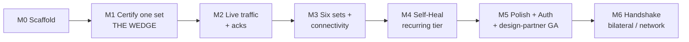

# 10 — Roadmap & Milestones

Build in vertical slices, in order. Each milestone is demoable end-to-end and gated by a Definition of Done. Do not build out of order. The fastest path to a credible product is a thin slice that **certifies one real transaction set**, then widen.

## Milestone map

---

### M0 — Scaffold & ground (foundation)
**Goal:** the monorepo runs on Cloudflare with all bindings, CI, and a deployable hello-world API + web shell.
- pnpm + Turborepo monorepo per CLAUDE.md §4. `apps/api`, `apps/web`, `packages/*` stubs.
- `wrangler.toml` with D1, KV, R2, Queues, DO bindings declared (account `1d40ee303e35970bbd47a10f8ad7d466`; dev subdomain on `tp-freight.com`). Secrets via `.dev.vars` (gitignored) + `.dev.vars.example`.
- D1 migrations for the `06` schema. R2 buckets. KV namespaces.
- `packages/edi-core`: evaluate and wrap a vetted X12 lib; round-trip a sample 214 in a unit test.
- `packages/canonical`: the `06` types + Zod schemas.
- CI: typecheck, lint, Vitest, the injection-harness skeleton; `fixtures/` seeded with ≥3 real-ish sample files per starting set.
- Dev-stub auth middleware (`X-Latch-Dev-Org`).
- **DoD:** `pnpm dev` runs api+web locally; `wrangler deploy` puts a hello API on the dev subdomain; CI green; a sample 214 round-trips through `edi-core`.

---

### M1 — Certify one transaction set (THE WEDGE) ★
**Goal:** the entire wedge in one thin slice for **214** (status — lowest operational risk, rich enough to prove the engine). Upload guide + samples → spec → map → golden corpus → injection → **visual certification**.
- `packages/spec`: Spec Ingestor for 214 (Claude-assisted; samples as ground truth; per-field confidence; deviation flags). Zod-validated output.
- `packages/mapgen`: generate inbound 214 map (declarative rules → canonical `StatusEvent`).
- `packages/transform`: deterministic engine executing the map (inbound + outbound for round-trip).
- `packages/verify`: golden synthesis (valid/boundary/qualifier/loop/deviation/adversarial) + the Proof + benchmark scoring.
- `apps/web`: the hero flow Screens 1–4 (`09`), incl. the live certification timeline and the visual report.
- API: onboarding + certify endpoints (`08`), async jobs + progress stream.
- **DoD:** a non-EDI-expert can upload a real 214 guide + samples and get a **green, benchmark-passing certification** with a coverage heatmap and round-trip gauge — no manual mapping. The injection harness gates this in CI. **This milestone alone is a credible demo and the basis of the GTM wedge.**

---

### M2 — Live traffic + acknowledgments
**Goal:** a certified 214 connection processes real inbound traffic over SFTP and emits 997s.
- `packages/connectivity`: SFTP adapter (poll inbound, archive R2, enqueue; outbound writes).
- `apps/pipeline`: queue consumer → parse → transform (pinned map version) → persist canonical → 997.
- `ConnectionDO`: control-number sequencing + idempotency/duplicate detection.
- "Go live" promotes the certified map to `production`; transaction index + detail + replay in the UI.
- **DoD:** drop a real 214 file on SFTP → it's parsed, transformed to canonical, persisted, and a 997 goes back; the transaction appears in the UI; replay works; duplicates are ignored.

---

### M3 — Six transaction sets + AS2
**Goal:** cover the transportation core and a second transport.
- Extend ingestor/mapgen/verify/transform to **204, 210, 211, 990, 997** (outbound included where relevant; 204↔990 pairing; 210 invoice; 211 BOL).
- AS2 adapter (signature/decrypt/MDN, encrypted cert material).
- Outbound generation (e.g. we emit a 990 in response to a 204; we emit 214/210 to a partner).
- Spec Library: every passing cert normalizes + accretes a spec entry.
- **DoD:** all six sets can be onboarded and certified; an inbound 204 produces a canonical `Tender` and a certified outbound 990 path exists; AS2 round-trips a transaction with MDN; the Spec Library shows accreted entries.

---

### M4 — Self-Heal (the recurring tier) ★
**Goal:** drift on live traffic is caught, patched, shadow-certified, and applied within policy — never silently breaking production.
- `packages/heal`: deterministic drift detection (schema) + cheap-classify (semantic anomaly); non-blocking in the pipeline.
- Patch proposal (Claude) → draft patched map → **shadow re-certification at the full benchmark bar**.
- Per-connection heal policy (auto-apply vs one-click approval); last-good map stays live until applied.
- UX: the drift timeline + approval flow + monthly health/"dollars protected" view (`09`).
- **DoD:** inject a drifted file (new qualifier) into a live connection → a DriftEvent opens, a patch is proposed and passes shadow cert, auto-applies within policy (or waits for approval), and the timeline tells the story in plain English. Live traffic never stalls.

---

### M5 — Polish, Auth, design-partner GA
**Goal:** real users can safely use it; the founding design partner is in production across their partner estate.
- **Clerk auth + multi-tenant** flip (the `tenant_id` columns become real; org/team management). This is the *only* point auth is built (CLAUDE.md §2.3).
- Hardening: rate limits, observability/alerting, R2 lifecycle, error budgets, secret-rotation runbook.
- UX polish to the `09` bar; share-link certification; mobile-respectable health/approvals.
- Onboard the design partner's full partner estate; capture the before/after case study (`12`).
- **DoD:** an external user signs up, connects a partner, certifies, and goes live with auth on; the design partner runs ≥N production connections through Latch; the case study (time/cost/quality before vs after) is documented.

---

### M6 — The Handshake (bilateral / network)
**Goal:** two Latch-aware parties stand up a connection agent-to-agent with a signed co-certification manifest.
- `packages/handshake`: the HSP state machine (`05`) in a `HandshakeDO`; Ed25519 signing; co-certification reusing `verify`.
- The **Latch-aware shim** contract for partners not fully on Latch.
- UX: "Connect via Latch" + the signed manifest view.
- **DoD:** two tenants (or a tenant + a shim) complete a handshake — HELLO → spec exchange → map negotiation → co-certification → signed/countersigned manifest → activate — and live traffic flows, with the whole thing visible and provable. The 50× endgame is demonstrable.

---

## Sequencing rationale

- **214 first (M1):** lowest operational risk (status, not dispatch/billing), structurally rich enough to exercise the full engine. Proves the wedge without operational dependencies.
- **204 later (M3), with 990:** the 204 feeds dispatch and is the only set with downstream operational dependencies — sequence it after the engine is proven, and always with its 990 response.
- **Self-heal (M4) before the handshake (M6):** the recurring-revenue tier and the "missing deliveries" story are higher near-term leverage than the network endgame; and the handshake's co-certification reuses the heal/verify machinery.
- **Auth last (M5):** per the standing guardrail — do not let auth block a functionally complete MVP.

## Definition of Done (every milestone)

- [ ] Demoable end-to-end from the UI or one command.
- [ ] CI green incl. the injection harness at the benchmark bar for all seeded connections.
- [ ] No secrets/hardcoded account or connection values; bindings declared.
- [ ] Errors typed + plain-English-surfaced.
- [ ] PR notes: assumptions, deferrals, what to verify.
- [ ] Docs/`TASKS.md` updated with any gaps or scope changes discovered.

## Suggested team-of-agents split (if parallelizing Claude Code)

- **Agent A — Engine:** `spec`, `mapgen`, `transform`, `verify` (M1, M3, M4 core). The hardest, highest-IP track.
- **Agent B — Platform:** `apps/api`, `apps/pipeline`, `connectivity`, DOs, D1/R2/Queues (M0, M2, M3).
- **Agent C — Experience:** `apps/web`, the visual reports, the drift timeline (M1, M4, M5) — using the `frontend-design` skill.
- Integrate at each milestone's DoD; the injection harness is the shared contract that keeps tracks honest.
