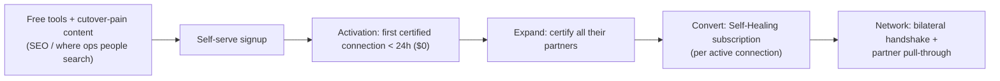

# 12 — GTM, Pricing & Packaging

The motion follows directly from the wedge: **$0, same-day, self-serve, provably correct.** That is a product-led, bottom-up motion, not an enterprise sales motion. Land free on one painful partner connection, expand across the estate, convert to the recurring self-healing tier.

## Positioning

**Category:** not "managed EDI" (the friction we kill) and not "iPaaS" (too broad). Latch is **certified EDI connections** — the place you stand up a trading-partner connection and *prove it's right*, same day, for free.

**One-liner:** *Connect to any trading partner's EDI in a day — certified, for $0 — and never get blindsided by a quiet change again.*

**The three claims, in priority order:**
1. **Proven, not probable.** Everyone else hands you a generated map and an accuracy score. We inject tested EDI through the map against golden records and hand you a **certification** (`07`).
2. **$0 to connect.** No services, no per-map fee. Self-serve onboarding is free.
3. **It heals itself.** Drift is caught and fixed before it costs you money (the recurring tier).

**Against incumbents** (AWS B2B DI, Orderful, Cleo, SPS, TrueCommerce): they sell *faster mapping* and/or *managed services* priced for the enterprise. Latch sells *provable correctness* and *self-serve $0 onboarding* to the firms those vendors leave stranded. Don't argue mapping speed — argue **proof** and **price** and **drift**.

## Go-to-market motion (PLG, bottom-up)

### 1. Top of funnel — own the moment of pain
Ops people in crisis Google their symptoms. Own that long-tail with **genuinely useful free tools** (each a demand magnet that previews the product):
- **X12 inspector** — paste/upload a file, get a clean, human-readable breakdown (segments, loops, qualifiers).
- **Companion-guide parser** — upload a PDF guide, see the structured spec Latch extracts (a live taste of the Ingestor).
- **997 / acknowledgment checker** and **204↔990 / 214 validators.**
- A short library on cutover survival and partner-drift ("why your deliveries went missing after go-live").
This matches the demand-trap / attraction-marketing playbook: useful free utility → captured intent → product.

### 2. The wedge campaign — cutover recovery
Target carriers/brokers **mid- or post-TMS-cutover** (the maximum-pain window from `11`). Message: *"Just survived a cutover that broke your EDI? Re-certify every partner connection in a day — free — and never get blindsided by drift again."* Channels: freight ops communities, TMS user groups, LinkedIn (operator voice), targeted outreach to firms known to have recently switched TMS.

### 3. Distribution leverage
- **TMS ecosystems:** integrations/marketplace presence for FACTS, McLeod, Turvo, Tai, Revenova — meet the ICP where they already work.
- **VAN frenemy:** partner with VANs for connectivity while owning the certification/mapping layer they don't.
- **Embed (B2B2B):** TMS/WMS/OMS vendors embed Latch as their EDI engine (`08`, `13`) — one integration, many downstream customers.
- **Partner pull-through:** every big partner on the other side of an onboarding is a warm lead and a future handshake node.

### 4. Proof engine — the founding case study
**The design partner (a regional LTL carrier mid-cutover) is proof case #1.** Re-certify their full national-partner estate and document the before/after: integration time (weeks → a day), cost (services + analyst → $0), quality (ad-hoc → benchmark certification), drift incidents caught. A concrete, named, freight-credible story is worth more than any feature list to the next ICP buyer. Capture it at M5 (`10`).

## Pricing & packaging

Designed so that the free tier **seeds the network** and the recurring tier **monetizes the durable value (keeping connections alive).**

| Tier | What's included | Price | Strategic role |
|---|---|---|---|
| **Certify (Free)** | Unlimited onboarding + certification; the visual report + share link; manual go-live; basic transaction processing at low volume | **$0** | The wedge. Kills incumbents' setup fees, drives activation, seeds the Spec Library/network |
| **Self-Heal (Monthly)** | Everything in Free **+ live drift monitoring, auto-patch + shadow re-certification, policy-gated auto-apply, health/"dollars protected" dashboard, alerting** | **Subscription per active connection / mo** (land-and-expand; volume tiers) | The recurring-revenue engine — insurance against the "missing deliveries" disaster |
| **Network (Handshake)** | Everything in Self-Heal **+ bilateral agent-to-agent handshake, signed co-certification manifests, partner-network instant onboarding** | **Premium per connection** or network access fee | The 50× endgame; monetizes the compounding moat |
| **Embedded / Enterprise** | White-labeled certification, scoped API, SLAs, SSO, dedicated support | **Platform / usage-based** | TMS/WMS vendors + the firms in Anti-ICP, reached via embed/partnership |

**Pricing principles:**
- **Onboarding is always free.** It is the customer-acquisition and network-seeding mechanism; never put it behind a paywall.
- **Charge for the connection staying alive, not for standing it up.** Self-healing is the thing worth a recurring check — it prevents recurring catastrophe.
- **Expansion is per-connection.** Land on one, grow to the whole estate; pricing scales naturally with value delivered.
- **Usage stays generous at the low end.** Don't nickel-and-dime transaction volume for the small ICP; monetize healing and network, not bytes.

## KPIs (instrument from day one)

| KPI | Definition | Target signal |
|---|---|---|
| **Activation** | % of signups with a certified connection within 24h | The PLG north star — drives everything downstream |
| **Time-to-first-certified-connection** | median signup → green cert | The wedge made measurable |
| **Connections certified** | count, total + per account | Top-line adoption |
| **Free → Self-Heal conversion** | % of accounts on the paid tier | The revenue conversion |
| **Connections per account (expansion)** | avg certified connections / account over time | Land-and-expand health |
| **Drift events caught** | count + "dollars protected" estimate | The value proof that justifies the subscription |
| **Net revenue retention** | recurring revenue retained + expanded | The durable-business signal |
| **Spec Library growth** | proven specs accreted | Moat / network compounding |
| **Logo retention** | % of paying accounts retained | Stickiness of the self-heal tier |

## Rollout sequence (GTM, mapped to product milestones in `10`)

1. **M1–M2 (wedge exists):** ship 2–3 free tools; publish the cutover-recovery content; onboard the design partner's first connections; begin capturing the case study.
2. **M3 (six sets):** open self-serve signup; run the cutover-recovery campaign; pursue 1–2 TMS marketplace listings.
3. **M4 (self-heal):** launch the **Self-Heal** paid tier; convert the free base; lead with "dollars protected."
4. **M5 (GA):** publish the design-partner case study; turn on auth; begin embed conversations with TMS/WMS vendors.
5. **M6 (handshake):** launch **Network** tier; activate partner pull-through; start compounding the spec-library moat.

## Founder/strategic note (read once, then execute)

This package is build-ready. The single highest-leverage GTM move is also the one that grounds the venture in real work rather than competing with it: **make the regional-carrier design partner both the first customer and the founding proof case.** The current EDI/cutover pain is not a distraction from the product — it *is* the product's first validation and its most credible story. Prove it there, document the before/after, and let that one named case open the next ten ICP doors.
